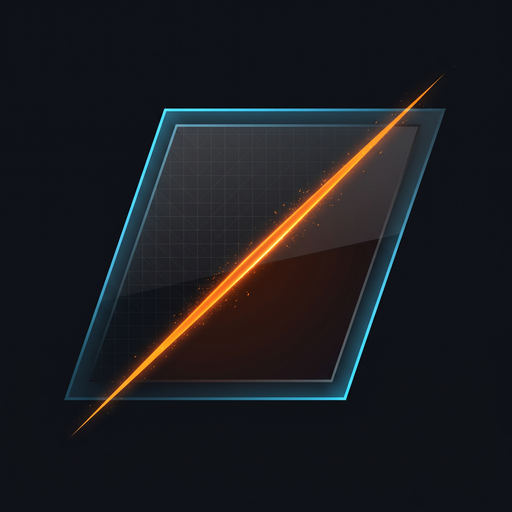
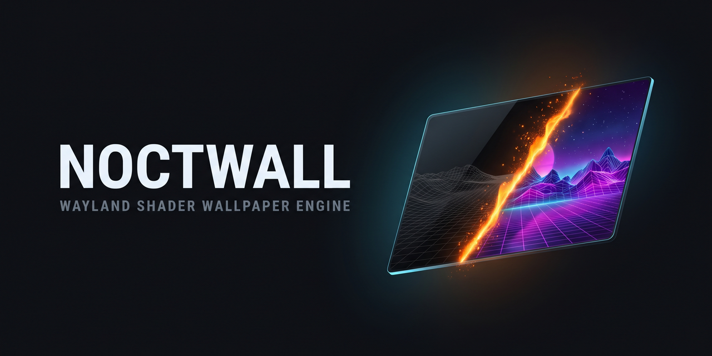
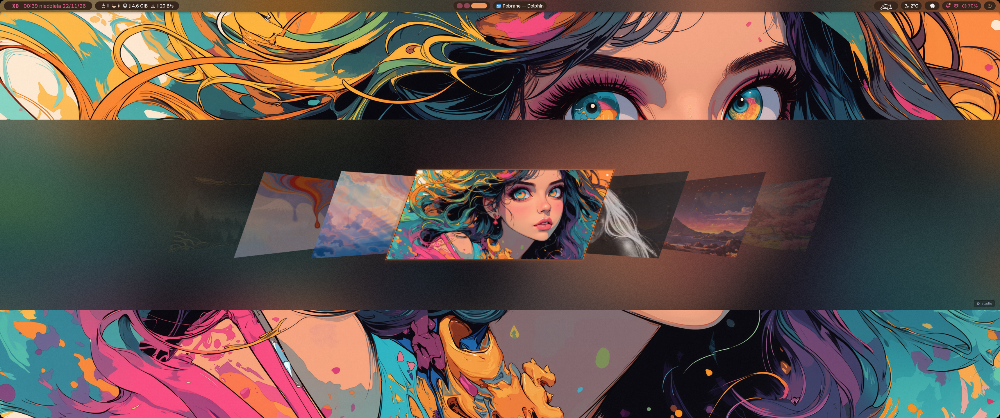

<div align="center">
  
  <h1>NoctWall Ecosystem</h1>
  <p><strong>Modular Wayland wallpaper transition engine, anti-aliased 3D perspective carousel, and live plugin ecosystem built with Quickshell, GLSL shaders, and OpenRGB.</strong></p>

  <p>
    
    
    
    
    
    
  </p>

  
</div>

---

## Live Demo

https://github.com/user-attachments/assets/e5897b4f-437a-4b91-ac4f-bc64ac10e22e

---

## Visual Showcase

### GPU-Accelerated Shader Transitions (`WallpaperFx`)

NoctWall analyzes wallpapers ahead of time using `noctwall-fx` and drives smooth, 60+ FPS fragment shader transitions (`wallfx.frag` compiled to `.qsb`):

- **`contagio`:** Organic distance-field spread radiating across 2D value-noise contours via Dijkstra shortest-path arrival maps.
- **`perfil`:** Local AI foreground silhouette detection (**BiRefNet**) that traces a glowing accent outline around characters and subjects before revealing the new wallpaper.

<p align="center">
  
</p>

---

### 3D Perspective Carousel (`WallpaperPicker`)

An interactive `wlr-layer-shell` wallpaper switcher featuring smooth anti-aliased 3D skewed cards, dynamic accent extraction, ambient pulse glow, multi-monitor cursor tracking, and instant IPC control.

<p align="center">
  
</p>

---

### Modular Plugins (`NoctWall Studio` & `NoctWall OpenRGB`)

- **NoctWall Studio (`noctwall-studio`):** Live in-UI configurator drawer (`studio` button in the bottom-right corner) for tuning card dimensions, skew angle, slot spacing, 3D perspective, side card borders, transition durations, glow intensity, active plugins, and wallpaper directories with atomic symlink-safe persistence to `config.json`.
- **NoctWall OpenRGB (`noctwall-openrgb`):** Extracts 5-zone palettes from the selected wallpaper (*Accent & Glow*, *Dominant Spread*, *Complementary*, *Analogous*, *Full Material*, or *Custom* user profiles) with live Saturation and Brightness sliders and asynchronous `openrgb` hardware synchronization.

<p align="center">
  
</p>

---

## Architecture

```text
noctwall-ecosystem/
├── assets/                 # Repository banner, logo, and UI showcase screenshots
├── install.sh              # Automated installer (venv, symlinks, shaders, systemd service)
├── noctwall/               # Core Quickshell daemon (WallpaperFx + WallpaperPicker + Plugin API)
│   ├── bin/noctwall-fx     # BiRefNet silhouette & Dijkstra arrival map generator + cache warmer
│   ├── shaders/            # GLSL fragment shaders & compiled .qsb binaries
│   ├── scripts/            # Thumbnail generator & wallpaper switching helpers
│   ├── plugins/            # Symlinked plugin slots (PluginWorker, BottomSlot, StageOverlay)
│   └── config.default.json # Default geometry, shader, path, and plugin configuration
├── noctwall-openrgb/       # 5-zone keyboard RGB sync plugin (Logitech G213 / OpenRGB)
└── noctwall-studio/        # Live in-UI geometry, shader & plugin configurator drawer
```

---

## Requirements & Heavy Dependencies

### 1. Core System Packages (Arch / CachyOS)
- **Wayland compositor** with `wlr-layer-shell` support (tested on **Hyprland**)
- **Quickshell** (`quickshell` / `qs`)
- **Qt 6 Shader Tools** (`qt6-shadertools` — provides `qsb` if recompiling `wallfx.frag`)
- **Python 3** (`python`) with `pillow`, `numpy`, and `scipy` (installed automatically into `~/.local/share/noctwall/venv` by `install.sh` for `contagio` maps)
- **ImageMagick** (`imagemagick` / `magick`) or **FFmpeg** (`ffmpeg`) for fast thumbnail generation
- **Wallpaper setter backend** (e.g., `swww`, `hyprpaper`, or `noctalia` — configured via `paths.wallpaperGetCmd` and `paths.wallpaperSetCmd` in `config.json`)

### 2. Local AI Silhouette Model (`perfil` Outline Transitions)
Out of the box, `install.sh` sets up lightweight dependencies for `contagio` transitions. To enable character/subject silhouette detection (`perfil`), `noctwall-fx` runs a local neural network completely offline:
- **Segmentation Model:** **BiRefNet** (`birefnet-general-lite`, ~210 MB ONNX weights downloaded on setup)
- **Python AI Runtime (~1.5–2 GB disk footprint):** `rembg`, `onnxruntime` (or `onnxruntime-gpu`), and `opencv-python-headless` inside `~/.local/share/noctwall/venv`
- Without the AI runtime installed, `noctwall-fx` gracefully falls back to `contagio` for all wallpapers.

### 3. Optional Hardware RGB Sync (`noctwall-openrgb`)
- **OpenRGB** (`openrgb` CLI + udev rules / i2c permissions for supported keyboards such as Logitech G213)

---

## Installation

```bash
git clone https://github.com/pstrokaty/noctwall-ecosystem.git
cd noctwall-ecosystem
./install.sh            # Core engine, 3D picker & Studio
# or:
./install.sh --with-ai  # Also installs BiRefNet runtime for perfil outline transitions
```

### Enabling AI Silhouette Masks (`perfil`)
Install the local `BiRefNet` runtime and pre-download the model weights (~210 MB):

```bash
~/.local/share/noctwall/venv/bin/pip install rembg onnxruntime opencv-python-headless
noctwall-fx warm ~/Pictures/Wallpapers
```

---

## Hyprland Keybind Examples

```ini
# Toggle interactive 3D wallpaper carousel
bind = SUPER ALT, Up, exec, qs -p ~/.config/noctwall ipc call picker toggle

# Cycle previous / next wallpaper immediately
bind = SUPER ALT, Left, exec, qs -p ~/.config/noctwall ipc call picker prev
bind = SUPER ALT, Right, exec, qs -p ~/.config/noctwall ipc call picker next

# Apply a random wallpaper from configured randomSubdir
bind = SUPER ALT, Down, exec, ~/.config/noctwall/scripts/random-wallpaper.sh
```

---

## Plugin API

Plugins reside in dedicated directories and are enabled via `plugins.enabled` in `noctwall/config.json`. Each plugin declares its supported UI and background slots in `plugin.json`:

- **`PluginWorker.qml`** — headless background worker reacting to `wallpaperPreviewed`, `wallpaperApplied`, `pickerClosed`, and `keyAction` signals.
- **`BottomSlot.qml`** — per-card interactive dock mounted directly beneath each carousel card.
- **`StageOverlay.qml`** — full-stage overlay layer for drawers, modals, and floating controls.

---

## Origins & Attribution (`pocket-dots`)

NoctWall started from the core shader transition engine of [**pocket-dots**](https://github.com/diegoMalagrida/pocket-dots) by [@diegoMalagrida](https://github.com/diegoMalagrida) (GPL-3.0) and evolved into a standalone, modular desktop ecosystem:

- **Extracted & Refactored from `pocket-dots`:**
  - The dual-mode transition pipeline (`noctwall-fx` + `wallfx.frag` + `WallpaperFx.qml`), combining precomputed 16-bit RGB arrival fields (`contagio` Dijkstra noise spread) and `BiRefNet` signed-distance silhouette maps (`perfil`) rendered on `WlrLayer.Bottom`.
  - Refactored `std140` shader uniform layout, configurable transition timings/glow parameters, and multi-monitor screen targeting.
- **Built from Scratch for `noctwall-ecosystem`:**
  - **3D Perspective Carousel (`WallpaperPicker.qml`):** Skewed `Matrix4x4` cards with multi-sampled layer edge anti-aliasing, per-wallpaper accent color extraction, ambient pulse glow, and live multi-monitor cursor tracking.
  - **Modular Plugin Architecture:** Hot-pluggable `PluginWorker`, `BottomSlot`, and `StageOverlay` slots with atomic symlink-safe `config.json` persistence.
  - **`noctwall-studio`:** Live in-UI geometry, shader, path, and plugin configurator drawer.
  - **`noctwall-openrgb`:** 5-zone keyboard lighting extraction engine with live HSV adjustments and background `openrgb` synchronization.
  - **`install.sh` & `systemd` Service:** Automated deployment script and `noctwall.service` user daemon.

---

## AI Models & Tooling

This project combines local on-device neural inference with AI-assisted software engineering:

- **Local Runtime Inference:** **BiRefNet (`birefnet-general-lite`)** via `rembg` and `ONNX Runtime` for offline foreground silhouette segmentation in `noctwall-fx`.
- **Development & Architecture:**
  - **Google Gemini** (**Gemini 3.1 Pro**, **Gemini 3.6 Flash**, **Gemini 3.8 Flash**, and **Gemini 4 Hydrogen**) — primary co-architect for QML/Wayland layer-shell integration, GLSL uniform debugging, 3D perspective & anti-aliasing math, plugin API design, `noctwall-studio`, `noctwall-openrgb`, and documentation.
  - **Anthropic Claude** (**Claude Sonnet 5.5**) — minor auxiliary code review and snippets.
  - **Alibaba Qwen (Local)** — on-device local iterations and helper scripting.

---

## License

**GPL-3.0** — see [LICENSE](LICENSE) for the full license text.
