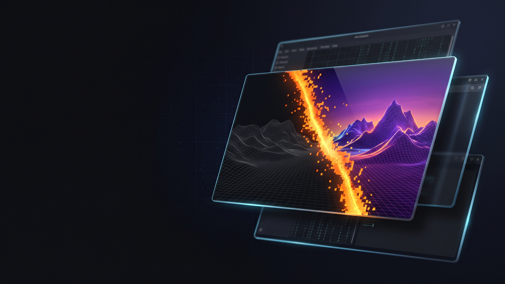
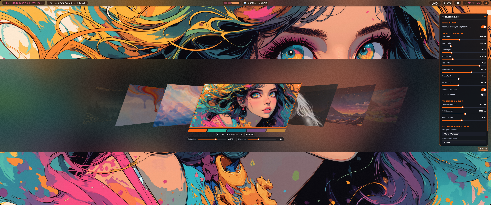

<div align="center">
  
  <h1>NoctWall Ecosystem</h1>
  <p><strong>Modular Wayland wallpaper transition engine, anti-aliased 3D perspective carousel, and live plugin ecosystem built with Quickshell, GLSL shaders, and OpenRGB.</strong></p>

  <p>
    
    
    
    
    
  </p>

  
</div>

---

## Live Demo

<!-- Drag and drop noctwall-demo.mp4 here in the GitHub web editor to embed the native inline player -->

---

## Visual Showcase

### GPU-Accelerated Shader Transitions (`WallpaperFx`)

NoctWall analyzes wallpapers ahead of time using `noctwall-fx` and drives smooth, 60+ FPS fragment shader transitions (`wallfx.frag` compiled to `.qsb`):

- **`contagio`:** Organic distance-field spread radiating across luminance and color contours.
- **`perfil`:** Foreground silhouette detection that traces a glowing accent outline around characters and subjects before revealing the new wallpaper.

<p align="center">
  
</p>

---

### 3D Perspective Carousel (`WallpaperPicker`)

An interactive layer-shell wallpaper switcher featuring smooth anti-aliased 3D skewed cards, dynamic accent extraction, ambient pulse glow, multi-monitor cursor tracking, and instant IPC control.

<p align="center">
  
</p>

---

### Modular Plugins (`NoctWall Studio` & `NoctWall OpenRGB`)

- **NoctWall Studio (`noctwall-studio`):** Live in-UI configurator drawer (`studio` button in the bottom-right corner) for tuning card dimensions, skew angle, slot spacing, 3D perspective, side card borders, transition durations, glow intensity, active plugins, and wallpaper directories with atomic symlink-safe persistence to `config.json`.
- **NoctWall OpenRGB (`noctwall-openrgb`):** Extracts 5-zone palettes from the selected wallpaper (*Accent & Glow*, *Dominant Spread*, *Complementary*, *Analogous*, *Full Material*, or *Custom* user profiles) with live Saturation and Brightness sliders and asynchronous `openrgb` hardware synchronization.

<p align="center">
  
</p>

---

## Architecture

```text
noctwall-ecosystem/
├── assets/                 # Repository banner, logo, and UI showcase screenshots
├── install.sh              # Automated installer (venv, symlinks, shaders, systemd service)
├── noctwall/               # Core Quickshell daemon (WallpaperFx + WallpaperPicker + Plugin API)
│   ├── bin/noctwall-fx     # Silhouette & distance-field mask generator and cache warmer
│   ├── shaders/            # GLSL fragment shaders & compiled .qsb binaries
│   ├── scripts/            # Thumbnail generator & wallpaper switching helpers
│   ├── plugins/            # Symlinked plugin slots (PluginWorker, BottomSlot, StageOverlay)
│   └── config.default.json # Default geometry, shader, path, and plugin configuration
├── noctwall-openrgb/       # 5-zone keyboard RGB sync plugin (Logitech G213 / OpenRGB)
└── noctwall-studio/        # Live in-UI geometry, shader & plugin configurator drawer
```

---

## Requirements

- **Wayland compositor** with `wlr-layer-shell` support (tested on **Hyprland**)
- **Quickshell** (`qs`)
- **Python 3** (`pillow`, `numpy`, `scipy` — installed automatically into an isolated venv by `install.sh`)
- **ImageMagick** (`magick`) or `ffmpeg` for fast thumbnail generation
- **OpenRGB** (`openrgb` CLI, optional — required only for `noctwall-openrgb`)

## Installation

```bash
git clone https://github.com/pstrokaty/noctwall-ecosystem.git
cd noctwall-ecosystem
./install.sh
```

## Hyprland Keybind Examples

```ini
# Toggle interactive 3D wallpaper carousel
bind = SUPER ALT, Up, exec, qs -p ~/.config/noctwall ipc call picker toggle

# Cycle previous / next wallpaper immediately
bind = SUPER ALT, Left, exec, qs -p ~/.config/noctwall ipc call picker prev
bind = SUPER ALT, Right, exec, qs -p ~/.config/noctwall ipc call picker next

# Apply a random wallpaper from configured randomSubdir
bind = SUPER ALT, Down, exec, ~/.config/noctwall/scripts/random-wallpaper.sh
```

## Plugin API

Plugins reside in dedicated directories and are enabled via `plugins.enabled` in `noctwall/config.json`. Each plugin declares its supported UI and background slots in `plugin.json`:

- **`PluginWorker.qml`** — headless background worker reacting to `wallpaperPreviewed`, `wallpaperApplied`, `pickerClosed`, and `keyAction` signals.
- **`BottomSlot.qml`** — per-card interactive dock mounted directly beneath each carousel card.
- **`StageOverlay.qml`** — full-stage overlay layer for drawers, modals, and floating controls.

## License

**GPL-3.0** — see [LICENSE](LICENSE) for the full license text.

## Credits

- Core shader transition concepts and initial wallpaper picker foundation derived from **pocket-dots** (GPL-3.0).
